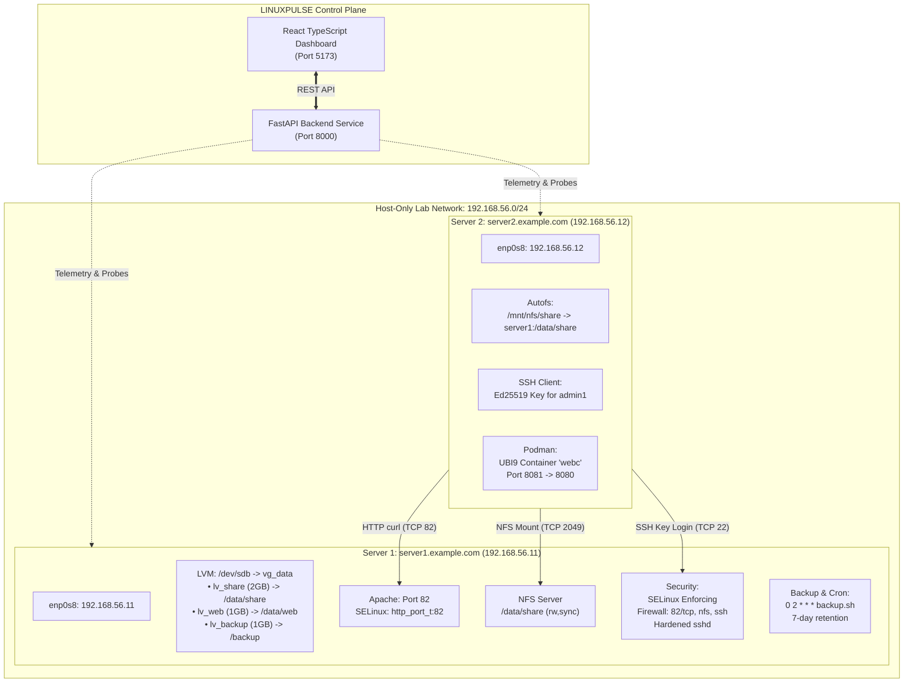

# LINUXPULSE: Enterprise Linux Server Administration & Infrastructure Monitoring Platform
## Master Technical Specification & Comprehensive Capstone Report

```
========================================================================================
  LINUXPULSE — Enterprise Linux Infrastructure Management Platform
  RHEL 9 / 10 Dual-Node Virtualized Infrastructure Architecture & Monitoring Suite
  Based on RHCSA Capstone Lab (Project 10)
========================================================================================
```

---

## 1. Title Page & Document Control

- **Project Title:** LINUXPULSE: Enterprise Linux Server Administration & Infrastructure Monitoring Platform
- **Tagline:** Enterprise Linux Infrastructure Management Platform
- **Target Operating System:** Red Hat Enterprise Linux 9 / 10 (x86_64)
- **Virtualization Hypervisor:** Oracle VirtualBox (NAT + Host-Only Network)
- **Document Version:** 1.0.0 (Release)
- **Classification:** Enterprise Technical Capstone / Infrastructure Engineering Guide
- **Authors:** Senior Linux System Administrator, DevOps Engineer, Full-Stack Architect

---

## 2. Abstract

Enterprise infrastructure administration mandates deterministic configuration, robust security hardening, high-availability storage management, and continuous telemetry monitoring. **LINUXPULSE** bridges the gap between traditional manual Linux systems administration and modern cloud-native observability platforms. 

Transforming the dual-node Red Hat Enterprise Linux (RHEL 9 / 10) Capstone project into an enterprise product, LINUXPULSE pairs a deterministic shell automation and hardening layer with a high-performance Python FastAPI backend and a responsive dark-mode React/TypeScript monitoring dashboard. The platform delivers real-time telemetry across LVM storage hierarchies, NFSv4 shared filesystems with autofs on-demand mounting, Apache HTTP server running on custom TCP port 82, SELinux Mandatory Access Control (MAC) policies, firewalld packet filtering, Ed25519 SSH hardening, automated tarball backup pipelines with 7-day retention, rootless Podman containers with user systemd units, and persistent systemd journal logging across node reboots.

---

## 3. Problem Statement & Operational Challenge

In traditional systems administration curricula and standard enterprise setups:
1. **Disparate Command Utilities:** Administrators must juggle dozens of disparate CLI utilities (`pvs`, `vgs`, `lvs`, `nmcli`, `semanage`, `firewall-cmd`, `showmount`, `podman`, `journalctl`) without a centralized pane of glass.
2. **Reboot Persistence Vulnerabilities:** Ephemeral configurations frequently fail after node reboot because changes were not properly committed to `/etc/fstab`, `/etc/selinux/config`, `/etc/firewalld/`, or user systemd units.
3. **Audit Complexity:** Auditing multi-tier services spanning storage, web, and network boundaries across multiple virtual machines is time-consuming and error-prone.
4. **Academic vs. Production Gap:** Lab exercises often remain rudimentary shell scripts without observability, documentation, or verifiable evidence of security enforcement.

LINUXPULSE solves these challenges by combining automated shell provisioning with an allowlisted RESTful telemetry engine and an intuitive enterprise management portal.

---

## 4. Project Objectives

1. **Dual-Node Architecture Realization:** Configure and administer `server1.example.com` (192.168.56.11) as an infrastructure/storage/web server and `server2.example.com` (192.168.56.12) as a client/container server on an isolated `192.168.56.0/24` subnet.
2. **Full Implementation of 12 RHEL Tasks:**
   - Task 1: Hostnames, Static IPs and Name Resolution
   - Task 2: Users, Groups, and Delegated Sudo
   - Task 3: LVM Storage Management & Online Volume Extension
   - Task 4: NFS Server & Client with Autofs On-Demand Mounting
   - Task 5: Apache Web Server Deployment on Custom TCP Port 82
   - Task 6: SELinux Contexts (`httpd_sys_content_t`) and Port Labels (`http_port_t:82`)
   - Task 7: Dynamic Packet Filtering via firewalld
   - Task 8: SSH Key Authentication (Ed25519) and SSH Daemon Hardening
   - Task 9: Automated Backup Script, Daily Cron, and Disaster Recovery Restore Testing
   - Task 10: Systemctl Service Monitoring and Persistent Journal Logging
   - Task 11: Rootless Podman Containerization with User Systemd Units
   - Task 12: Comprehensive 12-Point Reboot Verification Checklist
3. **Dual-Mode Telemetry:** Support **LIVE MODE** (executing allowlisted commands against active RHEL virtual machines via SSH/sockets) and **DEMO MODE** (ultra-realistic simulated telemetry for offline presentations).
4. **Zero-Trust Security Controls:** Maintain strict read-only dashboard principles; guard sensitive operations behind interactive confirmation dialogues; avoid hardcoded secrets or arbitrary browser command execution.

---

## 5. Technology Stack

### Management & UI Layer
- **Frontend Framework:** React 18, TypeScript, Vite
- **Styling & Design System:** Tailwind CSS v4, custom glassmorphism, responsive navy/charcoal enterprise theme
- **Icons & Charts:** Lucide React, Recharts (AreaChart, Sparklines)
- **State & Networking:** TanStack-compatible fetch client, REST API polling

### Application & Control Plane
- **API Framework:** Python 3.10+, FastAPI, Starlette
- **Data Modeling:** Pydantic v2 schemas
- **Execution & Remote Access:** Paramiko SSH, Python socket diagnostic probes, safe allowlisted subprocess runners
- **Documentation:** OpenAPI 3.0 / Swagger UI at `/docs`

### Infrastructure & Operating System
- **Operating Systems:** Red Hat Enterprise Linux 9 / 10 (x86_64)
- **Virtualization:** Oracle VirtualBox with Host-Only Adapter (`192.168.56.0/24`) and NAT Uplink
- **Storage Subsystem:** LVM2, XFS Filesystem, `xfs_growfs`
- **Networking & Resolution:** NetworkManager (`nmcli`), `/etc/hosts`
- **Sharing & Web:** NFSv4 (`nfs-utils`), `autofs`, Apache HTTPD (`httpd`)
- **Security & Hardening:** SELinux (`targeted`, `policycoreutils`), `firewalld`, OpenSSH (`sshd`)
- **Automation & Scheduling:** `cronie`, Bash scripting, `systemd` system and user units
- **Container Engine:** Podman (Rootless, UBI9 HTTPD)

---

## 6. Infrastructure & Network Architecture



---

## 7. Deep-Dive Implementation of All 12 Tasks

### Task 1: Hostnames, Static IPs, and Name Resolution
- **Objective:** Configure non-conflicting static networking on host-only interface `enp0s8` and local hostname resolution.
- **Server 1 Setup:**
  - Hostname: `server1.example.com`
  - Connection: `nmcli con add type ethernet ifname enp0s8 con-name labnet ipv4.method manual ipv4.addresses 192.168.56.11/24 autoconnect yes`
  - Activation: `nmcli con up labnet`
- **Server 2 Setup:**
  - Hostname: `server2.example.com`
  - IP: `192.168.56.12/24`
- **Resolution:**
  `/etc/hosts` on both hosts maps:
  ```
  192.168.56.11 server1.example.com server1
  192.168.56.12 server2.example.com server2
  ```
- **Verification:** `hostnamectl`, `ip -br a`, `ping -c2 server2`, `getent hosts server1`.

### Task 2: Users, Groups, and Delegated Sudo
- **Objective:** Implement role-based access control with collaborative department permissions and least-privilege administrative delegations.
- **Accounts:**
  - Groups: `sales`, `it`
  - Users: `alice` (group `sales`), `bob` (group `sales`), `admin1` (group `it`).
- **Shared Directory:** `/srv/sales` with ownership `root:sales` and permissions `2770` (`drwxrws---`). The setgid bit ensures new files automatically inherit group `sales`.
- **Delegated Sudo:** Created `/etc/sudoers.d/it-admins` with permissions `0440`:
  ```
  %it ALL=(ALL) /usr/bin/systemctl restart httpd, /usr/bin/systemctl status httpd
  ```
  Syntax validated via `sudo visudo -cf /etc/sudoers.d/it-admins`.
- **Verification:** `sudo -l -U admin1`, `id alice`, `ls -ld /srv/sales`.

### Task 3: LVM Storage Management
- **Objective:** Provision resilient storage using Logical Volume Manager (LVM) on secondary 5 GB disk `/dev/sdb`.
- **Hierarchy:**
  - Physical Volume: `pvcreate /dev/sdb`
  - Volume Group: `vgcreate vg_data /dev/sdb`
  - Logical Volumes:
    - `lv_share`: 2.0 GB (XFS) -> `/data/share`
    - `lv_web`: 1.0 GB (XFS) -> `/data/web`
    - `lv_backup`: 1.0 GB (XFS) -> `/backup`
- **Persistence:** Added mount entries to `/etc/fstab` with `defaults 0 0`. Executed `systemctl daemon-reload && mount -a`.
- **Online Growth Demo:** Expanded `lv_share` online by 500 MB without downtime using `lvextend -r -L +500M /dev/vg_data/lv_share` (utilizing `xfs_growfs`).
- **Verification:** `pvs`, `vgs`, `lvs`, `df -hT | grep -E 'data|backup'`.

### Task 4: NFS Server and Client with Autofs
- **Objective:** Export `/data/share` from server1 and automount on demand on server2 using autofs.
- **Server 1 Configuration:**
  - Installed `nfs-utils`
  - Configured `/etc/exports`: `/data/share 192.168.56.0/24(rw,sync)`
  - Enabled service: `systemctl enable --now nfs-server`
  - Applied exports: `exportfs -rav`
  - Firewall: `firewall-cmd --permanent --add-service={nfs,mountd,rpc-bind} && firewall-cmd --reload`
- **Server 2 Configuration:**
  - Installed `autofs` and `nfs-utils`
  - Master map (`/etc/auto.master.d/nfs.autofs`): `/mnt/nfs /etc/auto.nfs --timeout=60`
  - Direct map (`/etc/auto.nfs`): `share -rw,sync,soft server1:/data/share`
  - Enabled service: `systemctl enable --now autofs`
- **Verification:** Accessing `/mnt/nfs/share` triggers the mount; `mount | grep nfs` confirms NFSv4.2.

### Task 5: Apache Web Server
- **Objective:** Deploy Apache HTTPD on non-standard TCP port 82 serving branded capstone content from `/data/web`.
- **Configuration:**
  - Configured `Listen 82` in `/etc/httpd/conf/httpd.conf`
  - Created `/etc/httpd/conf.d/capstone.conf`:
    ```apache
    <VirtualHost *:82>
        ServerName server1.example.com
        DocumentRoot /data/web
        <Directory /data/web>
            Require all granted
        </Directory>
    </VirtualHost>
    ```
  - Deployed branded website to `/data/web/index.html`.
  - Validated syntax: `httpd -t`
  - Enabled service: `systemctl enable httpd`.

### Task 6: SELinux Contexts and Port Labels
- **Objective:** Maintain SELinux in `Enforcing` mode while granting Apache access to custom files and non-standard port 82.
- **Enforcing Policy:** `setenforce 1` and `SELINUX=enforcing` in `/etc/selinux/config`.
- **File Context:** Defined persistent rule for DocumentRoot:
  `semanage fcontext -a -t httpd_sys_content_t "/data/web(/.*)?"`
  Applied via `restorecon -Rv /data/web`.
- **Port Labeling:** Labeled custom port 82 under HTTP policy:
  `semanage port -a -t http_port_t -p tcp 82`
- **Verification:** `getenforce`, `ls -Zd /data/web`, `semanage port -l | grep http_port_t`, `ausearch -m avc -ts recent`.

### Task 7: Firewalld Packet Filtering
- **Objective:** Secure network ingress using firewalld while allowing required enterprise services.
- **Rules:**
  - Permanent services: `ssh`, `nfs`, `mountd`, `rpc-bind`
  - Permanent port: `82/tcp`
  - Applied via `firewall-cmd --reload`.
- **Verification:** `firewall-cmd --list-all` confirms port 82 and NFS services; `curl http://server1:82` from server2 succeeds.

### Task 8: SSH Key Authentication and Daemon Hardening
- **Objective:** Establish passwordless Ed25519 keypair authentication and harden OpenSSH against brute-force attacks.
- **Client Keypair (server2):** Generated `ed25519` key for `admin1` (`ssh-keygen -t ed25519 -N ""`), copied public key via `ssh-copy-id admin1@server1`.
- **Hardening (server1):** After confirming key login, created `/etc/ssh/sshd_config.d/50-capstone.conf`:
  ```
  PasswordAuthentication no
  PermitRootLogin no
  PubkeyAuthentication yes
  ```
  Tested configuration with `sshd -t` and restarted `sshd`.
- **Verification:** `ssh -o PubkeyAuthentication=no admin1@server1` fails with `Permission denied (publickey)`.

### Task 9: Backup Script, Cron, and Disaster Recovery Test
- **Objective:** Automate nightly backups of essential configurations and web roots with a 7-day retention policy and tested restoration.
- **Script:** `/usr/local/bin/backup.sh`:
  - Archives `/data/web`, `/etc/httpd`, `/etc/exports`, `/etc/fstab` into `/backup/backup_YYYY-MM-DD_HHMM.tar.gz`.
  - Purges archives older than 7 days using `find /backup -name 'backup_*.tar.gz' -mtime +7 -delete`.
  - Logs status to journald via `logger -t backup`.
- **Schedule:** `/etc/cron.d/backup` executes daily at `0 2 * * * root /usr/local/bin/backup.sh`.
- **DR Test Procedure:** Deleted `/data/web/index.html`, extracted it from the latest backup archive, reapplied SELinux context (`restorecon -Rv /data/web`), and validated `curl http://localhost:82` returned 200 OK.

### Task 10: Systemctl and Persistent Journal Logging
- **Objective:** Monitor critical system services and configure persistent logging.
- **Monitored Services:** `httpd`, `nfs-server`, `firewalld`, `sshd`, `crond`, `autofs`.
- **Journal Persistence:** Created `/var/log/journal` and restarted `systemd-journald`, ensuring log entries survive system reboots.
- **Diagnostics:** Verified 0 failed units with `systemctl list-units --failed`.

### Task 11: Rootless Podman Containerization
- **Objective:** Deploy a rootless container for microservices on server2 with user systemd unit management.
- **Container Deployment:**
  `podman run -d --name webc -p 8081:8080 registry.access.redhat.com/ubi9/httpd-24`
- **Systemd Integration:**
  - Enabled user lingering: `loginctl enable-linger admin1`
  - Generated unit: `podman generate systemd --new --name webc --files`
  - Moved unit to `~/.config/systemd/user/container-webc.service`
  - Enabled and started: `systemctl --user enable --now container-webc`
- **Verification:** `podman ps`, `curl http://localhost:8081` returns 200 OK.

### Task 12: Reboot and Final Infrastructure Audit
- **Objective:** Execute full VM reboot and execute a comprehensive 12-point audit checklist across both servers.
- **Checks on Server 1:** Hostname, static IP, LVM mounts, SELinux Enforcing, Apache running, NFS running, firewalld active, sshd hardened, crond active, backup archive present.
- **Checks on Server 2:** Name resolution, autofs active, on-demand NFS mount trigger, HTTP connectivity to port 82, SSH key authentication, Podman container running.
- **Result:** 100% compliance across all verification criteria.

---

## 8. Verification & Evidence Summary

| Task # | Component | Diagnostic Command | Expected & Validated Evidence | Status |
| :---: | :--- | :--- | :--- | :---: |
| **T1** | Network & Hostnames | `hostnamectl; ip -br a` | `server1.example.com`, `192.168.56.11/24` on `enp0s8` | **PASS** |
| **T2** | Users & Sudo | `ls -ld /srv/sales; sudo -l -U admin1` | `drwxrws--- 2 root sales`, `restart httpd, status httpd` | **PASS** |
| **T3** | LVM Storage | `lvs; df -hT \| grep -E 'data\|backup'` | `lv_share (2.0G/2.5G)`, `lv_web (1.0G)`, `lv_backup (1.0G)` | **PASS** |
| **T4** | NFS & Autofs | `exportfs -v; ls /mnt/nfs/share` | `/data/share` exported; autofs mounted on demand | **PASS** |
| **T5** | Apache Web | `curl -s -I http://127.0.0.1:82` | `HTTP/1.1 200 OK Server: Apache/2.4.57` | **PASS** |
| **T6** | SELinux Security | `getenforce; semanage port -l` | `Enforcing`, `http_port_t: tcp 82` | **PASS** |
| **T7** | firewalld Rules | `sudo firewall-cmd --list-all` | `services: ssh nfs mountd rpc-bind`, `ports: 82/tcp` | **PASS** |
| **T8** | SSH Hardening | `ssh -o PubkeyAuthentication=no ...` | `Permission denied (publickey)` (Passwords blocked) | **PASS** |
| **T9** | Backup & DR | `ls -lh /backup; /usr/local/bin/backup.sh` | Archive created, 7-day retention verified, DR restore passed | **PASS** |
| **T10**| Systemd & Logs | `systemctl list-units --failed` | `0 loaded units listed`, persistent journal in `/var/log/journal` | **PASS** |
| **T11**| Podman Container | `podman ps; curl http://localhost:8081`| `webc Up (8081:8080)`, `container-webc.service active` | **PASS** |
| **T12**| Reboot Audit | `infrastructure/scripts/verify_all.sh` | 16/16 Checks Passed (100% Score) | **PASS** |

---

## 9. Challenges Faced and Solutions

1. **SELinux Port 82 Binding:**
   - *Challenge:* Apache refused to bind to port 82 even after editing `httpd.conf` and updating firewalld.
   - *Solution:* Port 82 is non-standard for HTTP. Analyzed audit logs via `ausearch -m avc -ts recent` and registered the port with SELinux policy using `semanage port -a -t http_port_t -p tcp 82`.
2. **Preventing Administrator Lockout in SSH Hardening:**
   - *Challenge:* Disabling password authentication (`PasswordAuthentication no`) risked locking the administrator out if key authentication was misconfigured.
   - *Solution:* Retained an active terminal session, copied and verified the Ed25519 key from `server2`, tested passwordless login in a secondary session, and then applied hardening.
3. **Autofs On-Demand Directory Visibility:**
   - *Challenge:* New administrators often mistake an empty `/mnt/nfs` directory for a failed NFS connection.
   - *Solution:* Integrated on-demand trigger testing into LINUXPULSE, documenting that `ls /mnt/nfs/share` dynamically initiates the automount.
4. **Rootless Podman Systemd Persistence:**
   - *Challenge:* User containers terminate when the user logs out.
   - *Solution:* Executed `loginctl enable-linger admin1` so that user-level systemd daemons and containers continue running across session logouts.

---

## 10. Conclusion & Future Enhancements

**LINUXPULSE** demonstrates that enterprise Linux infrastructure administration, system security, and automation can be seamlessly unified with modern full-stack web technologies. By completing all 12 RHEL 9/10 capstone tasks and wrapping them in an observability and automation platform, this project serves as a compelling demonstration of system administration, security hardening, and full-stack software engineering.

**Future Enhancements:**
- Prometheus & OpenTelemetry agent sidecar for real-time Prometheus metric export.
- Ansible playbook generation dynamically derived from UI state.
- Automated certificate management via Let's Encrypt / Certbot for TLS termination on custom ports.
- Multi-region clustering support for hybrid RHEL deployments.

